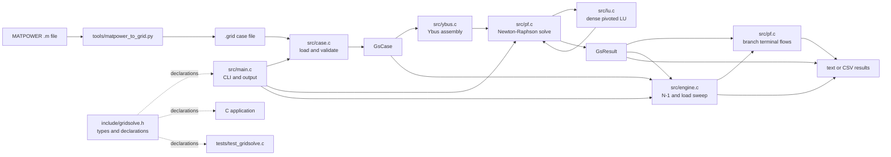
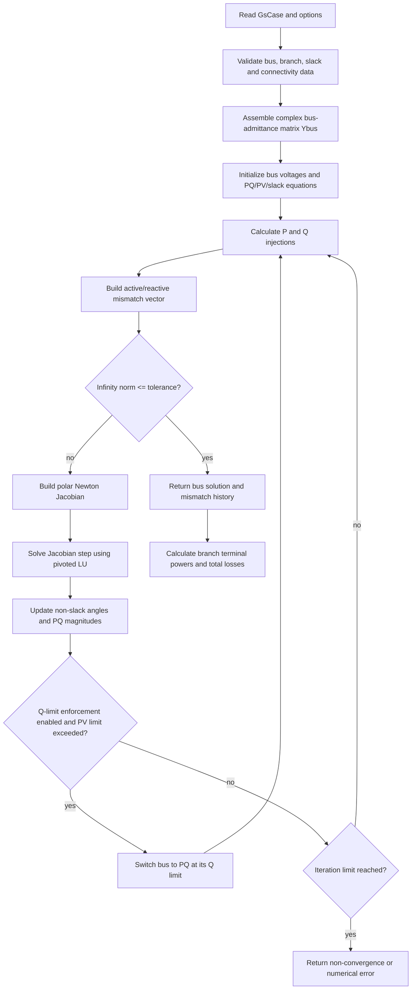

# GridSolve-C

GridSolve-C is a C11 dense AC power-flow solver using Newton-Raphson in polar coordinates, with branch flows, N-1 screening, and load scaling. It uses only libc and libm.

## Purpose and intended use

GridSolve-C calculates the steady-state operating point of a connected AC transmission or distribution network represented by bus and branch data. Given specified loads, generation, voltage targets, branch impedances, transformer settings, and shunts, it solves for bus voltage magnitudes and angles that satisfy the AC active- and reactive-power balance equations. It then calculates terminal powers and network losses. Optional features evaluate single-branch outages and track voltage/thermal violations as the load is scaled.

The project is intended as a compact, inspectable C reference implementation for learning, small-to-medium case studies, numerical experiments, regression checks, and embedding a power-flow calculation in a larger C program. Its command-line interface also makes it useful for batch runs and CSV output. The included 2-bus and 3-bus networks support hand-checkable experiments; the IEEE 14-bus case provides a larger benchmark example.

This program answers steady-state power-flow questions, such as:

- What voltage magnitude and phase angle does each bus settle to for the supplied operating point?
- What active and reactive powers flow into and out of each branch terminal, and what are the total losses?
- Which single in-service branch outages island the case, fail to converge, or cause voltage or thermal-limit violations?
- At what scaled load does the first modeled voltage/thermal violation appear, and at what scale does the numerical solution first fail?

It is not a transient-stability simulator, an optimal-power-flow or economic-dispatch optimizer, a protection study tool, or a full MATPOWER replacement. See [MATPOWER differences](#matpower-differences) and [Known limitations](#known-limitations) before using it for engineering decisions.

## Architecture

The executable path begins at the CLI, loads and validates the text case, then calls the solver or analysis engine. The public C API exposes those same operations for applications that do not need the CLI.



For a normal power-flow solve, the numerical work proceeds as follows:



## Repository guide

| Path                                                                  | Role                                                                                                                        |
| --------------------------------------------------------------------- | --------------------------------------------------------------------------------------------------------------------------- |
| `include/gridsolve.h`                                               | Public data types, status codes, options, results, and function declarations for C callers.                                 |
| `README.md`                                                         | Project overview, operating instructions, numerical-method notes, API/function guide, validation, and limitations.          |
| `.gitignore`                                                        | Excludes generated CLI/test executables and Python `__pycache__` from version control.                                    |
| `src/main.c`                                                        | Command-line interface for power flow (`pf`), single-branch contingency screening (`n1`), and load scaling (`sweep`). |
| `src/case.c`                                                        | Text case loading, validation, connectivity checking, cloning, and memory cleanup.                                          |
| `src/ybus.c`                                                        | Dense complex Ybus construction, including branch pi-model, transformer tap/phase shift, and bus shunts.                    |
| `src/pf.c`                                                          | Newton-Raphson power-flow solution and branch terminal-flow calculation.                                                    |
| `src/lu.c`                                                          | Dense complex LU factorization with partial pivoting for the Newton correction system.                                      |
| `src/engine.c`                                                      | Connectivity API, contingency ranking/screening, limit assessment, and load sweep.                                          |
| `src/common.c`                                                      | Shared logging, status descriptions, default solver options, and result cleanup.                                            |
| `tools/matpower_to_grid.py`                                         | Small text adapter from supported MATPOWER case assignments to `.grid` input.                                             |
| `data/two_bus.grid`                                                 | Two-bus lossless example used for hand-derived voltage and branch-flow checks.                                              |
| `data/three_bus.grid`                                               | Three-bus, two-section lossless example with a zero-injection midpoint.                                                     |
| `data/case14.grid`                                                  | MATPOWER-derived IEEE 14-bus benchmark input.                                                                               |
| `tests/test_gridsolve.c`                                            | C regression tests for numerical methods, benchmark comparisons, errors, contingencies, and sweeps.                         |
| `Makefile`                                                          | Build, test, sanitizer, and cleanup targets.                                                                                |
| `gridsolve`, `tests/test_gridsolve`, `tests/test_gridsolve_san` | Generated executable artifacts created by the build/test targets; these are not source files.                               |

## C API and function guide

`include/gridsolve.h` is the API contract. Callers create or load a `GsCase`, configure a `GsOptions` value (or use `gs_default_options()`), call a calculation function, inspect its result, and release owned memory with the corresponding free function. Functions return a `GsStatus`; `gs_status_string()` converts a status to readable text.

### Public data types

- `GsStatus` distinguishes success from I/O, parse, invalid-input, allocation, singular-system, non-convergence, and islanding failures.
- `GsBusType` assigns MATPOWER-compatible bus types: `GS_PQ`, `GS_PV`, and `GS_SLACK`.
- `GsLogLevel` selects the severity threshold used by `gs_log()`.
- `GsBus` stores a bus ID/type; initial or controlled voltage; angle; active/reactive demand and generation; shunts; voltage limits; and reactive-generation limits. Power values are MW/MVAr, shunts are pu.
- `GsBranch` stores endpoint IDs, in-service status, series resistance/reactance, total line charging, off-nominal tap ratio, phase shift, and MVA `rate_a`.
- `GsCase` owns the base MVA, bus and branch counts, and dynamically allocated arrays of `GsBus` and `GsBranch` records.
- `GsOptions` controls mismatch tolerance, maximum Newton iterations, Q-limit enforcement, flat start, and log level.
- `GsResult` owns solved bus voltage magnitude/angle and net injection arrays plus mismatch history, iteration/mismatch summary, and total active/reactive losses. Angles in the result are radians; injections are pu.
- `GsFlow` holds active and reactive power at both branch ends, in MW/MVAr.
- `GsContingencyResult` identifies the original branch index, solve/islanding status, voltage and overload counts, and aggregate violation severity.

### Public functions

| Function                                                                        | What it does and when to use it                                                                                                                                                                                                         |
| ------------------------------------------------------------------------------- | --------------------------------------------------------------------------------------------------------------------------------------------------------------------------------------------------------------------------------------- |
| `gs_log(level, configured_level, format, ...)`                                | Writes a formatted message to standard error when its severity is enabled. Used by the CLI for errors and by solver diagnostics.                                                                                                        |
| `gs_status_string(status)`                                                    | Returns a human-readable description of a `GsStatus`. Use when reporting API errors.                                                                                                                                                  |
| `gs_default_options()`                                                        | Returns defaults: `1e-8` pu tolerance, 20 iterations, Q limits disabled, non-flat initial angles, warning-level logging.                                                                                                              |
| `gs_case_load(path, out)`                                                     | Parses a `.grid` file, applies the default 100 MVA base if omitted, validates it, and returns an owned case.                                                                                                                          |
| `gs_case_free(grid)`                                                          | Frees the case's bus and branch arrays and resets the structure. Safe to call with `NULL`.                                                                                                                                            |
| `gs_case_validate(grid)`                                                      | Checks pointers, finite values, IDs, bus/branch fields, exactly one slack bus, branch references, and connectedness of in-service buses.                                                                                                |
| `gs_case_clone(source, out)`                                                  | Allocates and copies a case. Used by contingency and sweep analyses so they can change a working copy without mutating caller data.                                                                                                     |
| `gs_ybus(grid, out)`                                                          | Builds a newly allocated dense `nbus x nbus` complex nodal-admittance matrix. The caller owns and must `free()` the returned matrix.                                                                                                |
| `gs_lu_solve(n, matrix, rhs)`                                                 | Solves the in-place dense complex linear system `matrix * x = rhs`, replacing `rhs` with the solution; reports singular/ill-conditioned pivots.                                                                                     |
| `gs_solve(grid, options, out)`                                                | Solves the AC power-flow equations, optionally switching PV buses to PQ when their aggregate Q limits are exceeded. The result owns allocated arrays and must be released with `gs_result_free()`.                                    |
| `gs_result_free(result)`                                                      | Frees all arrays owned by a `GsResult` and resets it.                                                                                                                                                                                 |
| `gs_branch_flows(grid, result, flows)`                                        | Computes each in-service branch's from/to terminal P and Q from a solved voltage state. Caller supplies an array of `grid->nbranch` flows.                                                                                            |
| `gs_connectivity(grid)`                                                       | Public connectivity check; currently delegates to `gs_case_validate()`, so it also rejects invalid case data, not just disconnected topology.                                                                                         |
| `gs_n1(grid, options, out, count)`                                            | Outages each in-service branch in turn, detects islanding, solves each remaining connected case from a flat start, assesses voltage and thermal limits, ranks outcomes, and returns an allocated array that the caller must `free()`. |
| `gs_sweep(grid, options, start, stop, step, first_violation, collapse_point)` | Scales bus active/reactive demands over an inclusive factor range using flat-start solves. Reports the first voltage/thermal violation and first singular/non-convergent scale as factors; values remain `NAN` if not reached.        |

### File-local functions and test helpers

These are implementation details, not callable parts of the public API:

| File                          | Function/helper                        | Responsibility                                                                                                                           |
| ----------------------------- | -------------------------------------- | ---------------------------------------------------------------------------------------------------------------------------------------- |
| `src/case.c`                | `bus_index()`                        | Finds a bus's array position from its external ID for validation and topology traversal.                                                 |
| `src/ybus.c`                | `index_of()`                         | Maps a branch endpoint ID to a bus-array index during Ybus stamping.                                                                     |
| `src/pf.c`                  | `bus_index()`                        | Maps branch terminal IDs to result voltage-array positions for flow calculations.                                                        |
| `src/pf.c`                  | `injections()`                       | Evaluates calculated nodal active and reactive power from Ybus and the current voltage magnitudes/angles.                                |
| `src/engine.c`              | `rank_results()`                     | Orders outage results with non-success statuses first, then larger severity, then branch index.                                          |
| `src/engine.c`              | `assess()`                           | Counts voltage-limit violations and branch-end apparent-power overloads and accumulates severity.                                        |
| `src/main.c`                | `parse_double()`                     | Strictly parses a finite numeric CLI option.                                                                                             |
| `src/main.c`                | `parse_int()`                        | Strictly parses a positive CLI integer bounded to 1 through 1,000,000.                                                                   |
| `src/main.c`                | `usage()`                            | Prints CLI syntax to standard error.                                                                                                     |
| `src/main.c`                | `print_pf()`                         | Prints a solved case as a readable table or bus/branch CSV records.                                                                      |
| `src/main.c`                | `main()`                             | Parses mode/options, loads a case, calls the selected API operation, prints results, and frees owned objects.                            |
| `tests/test_gridsolve.c`    | `CHECK` macro                        | Counts assertions and reports a failed expression with its source location.                                                              |
| `tests/test_gridsolve.c`    | `two_terminal_hand_solution()`       | Computes the high-voltage closed-form two-terminal reference used by the small-network tests.                                            |
| `tests/test_gridsolve.c`    | `test_lu()`                          | Checks a known 2x2 solution and singular-matrix detection.                                                                               |
| `tests/test_gridsolve.c`    | `test_ybus_and_two_bus()`            | Checks Ybus properties, invalid output handling, hand-derived voltage, and branch powers.                                                |
| `tests/test_gridsolve.c`    | `test_three_bus()`                   | Checks the endpoint solution and midpoint-phasor relationship for the three-bus case.                                                    |
| `tests/test_gridsolve.c`    | `test_q_limits_and_quadratic_rate()` | Exercises PV Q-limit switching, voltage regulation without switching, and local Newton convergence behavior.                             |
| `tests/test_gridsolve.c`    | `test_ieee14_web_reference()`        | Compares IEEE-14 bus voltage/angle, from-end active branch flows, and total active loss with the recorded browser-reference arrays.      |
| `tests/test_gridsolve.c`    | `test_failures_and_balance()`        | Checks injection/loss balance, islanding, invalid data, and a deliberately non-convergent load.                                          |
| `tests/test_gridsolve.c`    | `test_contingency_and_sweep()`       | Exercises N-1 rankings/overloads, first limit violation, and load-collapse reporting.                                                    |
| `tests/test_gridsolve.c`    | `main()`                             | Runs every test group, prints check/error summaries, and returns a failing process status if any check fails.                            |
| `tools/matpower_to_grid.py` | `matrix(text, name)`                 | Extracts supported numeric matrix assignments from MATPOWER text.                                                                        |
| `tools/matpower_to_grid.py` | `scalar(text, name, default)`        | Extracts a supported numeric scalar assignment or returns a supplied default.                                                            |
| `tools/matpower_to_grid.py` | `convert(source, destination)`       | Reads supported baseMVA/bus/gen/branch assignments, combines online generator values by bus, converts shunts, and writes `.grid` text. |
| `tools/matpower_to_grid.py` | `main()`                             | Defines the converter's two positional file arguments and invokes `convert()`.                                                         |

The other source files contain only the public functions listed above: `src/common.c` implements logging/status/defaults/cleanup; `src/lu.c` implements the linear solver; and `src/ybus.c` implements admittance assembly. `Makefile` recipes are build rules rather than C functions.

## Build and run

```sh
make
make test
make sanitize
./gridsolve pf data/two_bus.grid
./gridsolve n1 data/three_bus.grid --csv
./gridsolve sweep data/two_bus.grid --step 0.05
```

The required compiler flags are `-std=c11 -Wall -Wextra -Wpedantic -Werror`. The default solve tolerance is `1e-8` pu with a maximum of 20 Newton iterations. Options are `--tol <pu>`, `--maxit <count>`, `--qlim` to enable PV-to-PQ switching, `--csv`, and `--step <scale increment>` for sweeps. Sweep endpoints are 0.5x and 1.5x load. Q-limit enforcement is off by default.

| Command/option           | Behavior                                                                                                                           |
| ------------------------ | ---------------------------------------------------------------------------------------------------------------------------------- |
| `make` or `make all` | Compiles the `gridsolve` command-line executable.                                                                                |
| `make test`            | Builds and runs the C regression suite.                                                                                            |
| `make sanitize`        | Builds and runs the same suite with AddressSanitizer and UndefinedBehaviorSanitizer.                                               |
| `make clean`           | Removes generated executable files.                                                                                                |
| `gridsolve pf CASE`    | Solves one operating point and prints bus results, total losses, and terminal flows.                                               |
| `gridsolve n1 CASE`    | Outages each in-service branch one at a time and prints ranked screening results.                                                  |
| `gridsolve sweep CASE` | Scales active/reactive demand from 0.5 to 1.5 in increments of `--step` and reports the first violation and first solve failure. |
| `--tol VALUE`          | Sets the positive Newton mismatch tolerance in per-unit.                                                                           |
| `--maxit COUNT`        | Sets the positive maximum Newton iteration count (CLI accepts 1 through 1,000,000).                                                |
| `--qlim`               | Enables per-bus aggregated reactive generation limit enforcement and PV-to-PQ switching during each solve.                         |
| `--csv`                | Prints power-flow bus/branch records or N-1/sweep summaries as CSV.                                                                |
| `--step VALUE`         | Sets the positive sweep scale increment; defaults to `0.05`.                                                                     |

The general invocation is `./gridsolve pf|n1|sweep CASE [OPTIONS]`. `--tol` and `--maxit` configure solves used by any mode; `--qlim` is passed to the solver used by each mode. `--step` affects only `sweep`. CSV is output formatting, not a different calculation. The C build uses GCC or a compatible C11 compiler and libc/libm; Python 3 is required only when running the MATPOWER converter.

## Case format

Each non-comment line is one record. Bus and branch IDs are one-based integers; bus records are ordered as shown. Loads and generation are MW/MVAr, shunts are per-unit, branch impedance/charging are per-unit, transformer shift is degrees, and `rateA` is MVA. A missing `BASEMVA` defaults to 100 MVA. Branch tap ratio 1 and phase shift 0 represent an ordinary line. `rateA` 0 means unlimited.

```text
BASEMVA 100
BUS id type Vm Va_deg Pd Qd Pg Qg Gs Bs Vmin Vmax Qmin Qmax
BRANCH from to r x b tap shift_deg rateA status
```

`BASEMVA` sets the system power base in MVA. `BUS` fields, in order, are: bus ID; type (`1` PQ, `2` PV, `3` slack); voltage magnitude in pu; voltage angle in degrees; active/reactive demand; active/reactive generation; conductance/susceptance shunts in pu; minimum/maximum voltage in pu; and minimum/maximum reactive generation. The given voltage magnitude is held for PV and slack buses; PQ buses are initialized to 1 pu by this implementation. The slack voltage magnitude and angle are fixed, while its generated P and Q balance the network. A PV bus specifies P and voltage magnitude, and its Q is calculated (and optionally limited); a PQ bus specifies net P and Q.

`BRANCH` fields, in order, are: from-bus ID; to-bus ID; series resistance `r`; series reactance `x`; total line-charging susceptance `b`; off-nominal tap ratio; phase shift in degrees; `rateA` MVA limit; and in-service status (`1` in service, `0` out). The line charging is divided equally between the two ends in the pi model. Zero tap is not valid in `.grid` input; use `1` for an ordinary line. Bus records must have unique positive IDs, and exactly one slack bus is required.

Bus types follow MATPOWER: 1 PQ, 2 PV, 3 slack. Exactly one slack is required. All in-service buses must be connected. Impedance must be finite, nonnegative, and not jointly zero. The MATPOWER converter accepts standard `mpc.baseMVA`, `mpc.bus`, `mpc.gen`, and `mpc.branch` assignments:

```sh
python3 tools/matpower_to_grid.py case.m data/case.grid
```

It aggregates online generators at each bus and converts MATPOWER bus shunts to per-unit. The converter is a text-format adapter, not a MATLAB interpreter; expressions or computed matrix entries are unsupported.

## Numerical method

Ybus is dense and complex, assembled with the MATPOWER pi-model tap/phase-shift convention and bus shunts. The real polar Newton system uses active-power equations for non-slack buses and reactive-power equations for PQ buses. The dense Jacobian is solved by complex-storage LU with partial pivoting; pivots at or below `1e-12` of the matrix maximum are rejected as singular or ill-conditioned. The mismatch is the infinity norm in per-unit. Invalid cases, islanding, singular systems, allocation errors, and non-convergence return distinct status codes.

Branch terminal powers use the same pi-model and are reported in MW/MVAr. Total losses are the sum of both terminal powers. Power balance is checked as total generation minus total demand minus losses. N-1 outages are checked for islanding before the flat-start re-solve. Connected results are screened against bus Vmin/Vmax and apparent flow at both ends against rateA; the ranked report puts islanded/non-convergent outcomes first, then sorts by violation severity. Load sweep records the first voltage/thermal violation and continues to locate the first non-convergent or singular scale.

## MATPOWER differences

The specified transformer stamping convention is preserved. This implementation does not model MATPOWER generator cost/data, generator active-power bounds, phase-angle branch limits, switched shunts, remote voltage regulation, or multiple independent generator reactive dispatch at one bus. Online generator Q limits are aggregated per bus and optionally enforce a PV-to-PQ switch; enforcement defaults off as in MATPOWER. PQ buses start at 1 pu and zero degrees rather than using MATPOWER's case voltage start values. Branch thermal screening uses the larger terminal MVA against rateA. The dense algorithm is intended for small and medium cases, not large transmission systems.

## Validation

The 2-bus expected voltage is derived from the high-voltage root of the lossless two-terminal power equations; the 3-bus case is two identical lossless sections with a zero-injection midpoint. Tests compare bus voltage and angle with those closed-form calculations and also check branch powers, losses, balance, and the midpoint phasor.

The IEEE-14 input is based on the [official MATPOWER case14.m benchmark data](https://raw.githubusercontent.com/MATPOWER/matpower/master/data/case14.m). The checked-in IEEE-14 expected bus and branch active-flow values are attributed by the existing regression to the [EEE Roadmap IEEE-14 browser solver](https://eee-roadmap.muhammadhazimiyusri.uk/learn/power-systems/power-flow-ieee14/); the test comment and prior project notes say these arrays were extracted from its in-page solver at full precision. Its recorded solve was 3 iterations with maximum mismatch `5.977922329369889e-8 pu`. The repository supplies the MATPOWER-derived input and recorded browser result arrays; it does not contain a solved MATPOWER output file.

The browser comparison is a numerical cross-check, not an industry-grade independent validation. No MATPOWER, PYPOWER, pandapower, Octave, or MATLAB power-flow solver was installed in the checked environment, and the browser solver was not executed during this validation. Thus, the checked-in reference arrays were compared as they stand; their source was not freshly queried. The browser reference comparison covers bus voltage magnitude, bus angle, from-end active branch flow, and total active loss, but not reactive branch flow.

| Validation source                           |     Maximum voltage error |        Maximum angle error | Flow/loss comparison                                               |
| ------------------------------------------- | ------------------------: | -------------------------: | ------------------------------------------------------------------ |
| 2-bus and 3-bus closed-form hand references | `7.336609098019e-11 pu` | `3.387048218464e-09 deg` | Balance and loss identities pass                                   |
| IEEE-14 recorded browser-solver arrays      | `5.379532375116e-09 pu` | `4.712322212441e-07 deg` | Branch P `3.878557265580e-06 MW`; loss `6.041994087269e-07 MW` |

IEEE-14 regression tolerances are `1e-6 pu` for voltage magnitude, `1e-4 deg` for bus angle, and `1e-4 MW` for each branch's from-end active flow and total active loss. No material numerical deviation was found in these compared quantities.

Fresh CLI runs from the rebuilt executable:

| Case                           | Result                                                                                            |
| ------------------------------ | ------------------------------------------------------------------------------------------------- |
| `data/two_bus.grid`          | Converged in 3 iterations; mismatch `1.692e-10 pu`; losses `0.000000 MW`, `3.030399 MVAr`   |
| `data/three_bus.grid`        | Converged in 3 iterations; mismatch `4.886e-10 pu`; losses `0.000000 MW`, `2.092455 MVAr`   |
| `data/case14.grid` (IEEE-14) | Converged in 3 iterations; mismatch `2.878e-09 pu`; losses `13.393272 MW`, `30.122388 MVAr` |

Validation commands and results in this checkout:

| Command           | Result                                                                                 |
| ----------------- | -------------------------------------------------------------------------------------- |
| `make all`      | Passed with GCC strict warnings (`-Wall -Wextra -Wpedantic -Werror`)                 |
| `make test`     | **114 checks, 0 failures**                                                       |
| `make sanitize` | **114 checks, 0 failures** under AddressSanitizer and UndefinedBehaviorSanitizer |

The test suite covers LU solve/singularity, Ybus and 2-bus solution, the 3-bus hand solution, PV reactive-limit switching and Newton convergence behavior, IEEE-14 reference comparison, failure cases and power balance, and contingency/load-sweep behavior. It also checks that `gs_ybus` clears its output pointer when called with an invalid grid. During this validation, the strict build initially failed because Ybus initialization was compressed onto the same line as an early return, triggering `-Wmisleading-indentation`; the statements were separated. The invalid-input output-pointer behavior was also corrected and covered by a regression. The strict production build, tests, and sanitizer target then passed. Clang and Valgrind were unavailable.

## Known limitations

The Ybus and Jacobian are dense; LU work and memory grow cubically and quadratically, respectively. The solver reports PV bus reactive output from the solved injection but does not dispatch multiple generators independently. This is steady-state positive-sequence AC power flow only: there is no dynamics, protection, optimal power flow, or automatic controls beyond optional Q-limit switching. N-1 screening uses flat start for each outage and does not rank by a probabilistic risk model.
